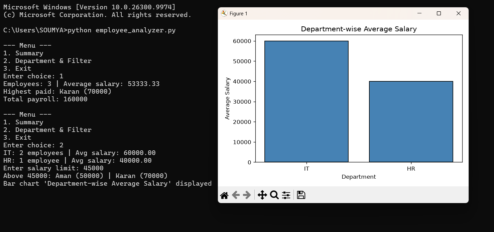
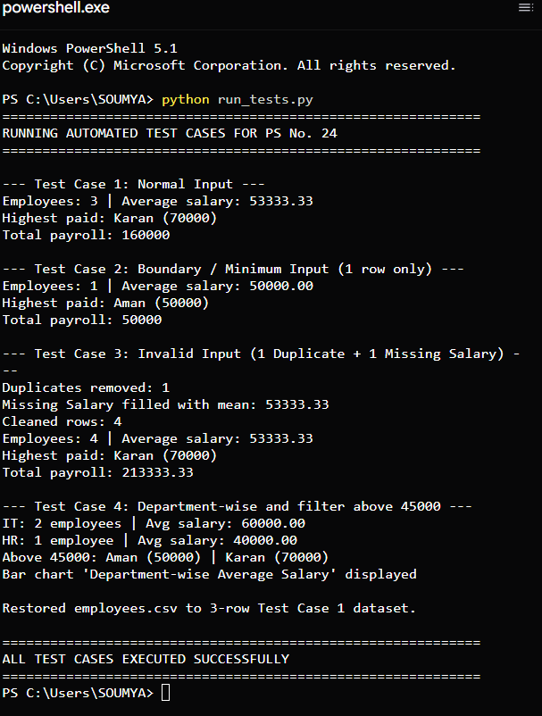

# Employee Data Analyzer (PS No. 24)

**Course:** Programming Fundamentals and Logic Building Using Python (`RU-100-01-0021`)  
**Institution:** Rungta International Skills University, Bhilai, Chhattisgarh  
**School:** School of Computer Science and Engineering  
**Student Name:** Soumya Kumar Jha  
**Enrollment / Roll No.:** 26-00903  
**Program:** B.Tech CSE (AI & ML) — First Semester / Section – 1J  

---

## Overview
A console-based Python 3 data analysis application developed for **Problem Statement No. 24**. It loads employee records from `employees.csv`, cleans duplicate entries and missing salary values via mean imputation, computes workforce and payroll metrics, groups statistics by department, filters high earners using boolean indexing, and plots a Matplotlib bar chart.

---

## Key Features
- **Automated Data Cleaning:** Removes duplicate rows (`drop_duplicates()`) and imputes missing `Salary` values using the arithmetic mean of valid salaries (`fillna()`).
- **Workforce & Payroll Summary (Option 1):** Computes total employee count, average salary, highest-paid employee (`idxmax()`), and total organization payroll.
- **Department-wise Grouping (Option 2):** Uses Pandas `groupby()` to calculate employee count and average salary per department.
- **Boolean Salary Filtering:** Lists all employees earning strictly above a user-entered salary threshold.
- **Data Visualization:** Renders a labeled Matplotlib bar chart titled **`Department-wise Average Salary`**.

---

## Dataset Schema (`employees.csv`)
The input CSV file uses dummy employee records structured with five columns:
```csv
Emp_ID,Name,Department,Salary,Experience
E1,Aman,IT,50000,3
E2,Riya,HR,40000,2
E3,Karan,IT,70000,5
```

---

## Prerequisites & Installation
- **Python 3.10+**
- **Required Libraries:** `pandas`, `matplotlib`

Install the dependencies via pip:
```bash
pip install pandas matplotlib
```

---

## How to Run
1. **Run the main interactive console application:**
   ```bash
   python employee_analyzer.py
   ```
   - Enter `1` for the overall workforce & payroll summary.
   - Enter `2` for department-wise statistics, salary threshold filtering, and the bar chart.
   - Enter `3` to exit.

2. **Run automated test verification (Test Cases 1–4):**
   ```bash
   python run_tests.py
   ```

---

## Verified Test Cases
| Test Case | Scenario | Expected & Verified Result |
| :--- | :--- | :--- |
| **Test Case 1** | Normal 3-row input (`Option 1`) | `Employees: 3 \| Average salary: 53333.33`, `Highest paid: Karan (70000)`, `Total payroll: 160000` |
| **Test Case 2** | Boundary 1-row input (`Option 1`) | `Employees: 1 \| Average salary: 50000.00`, `Highest paid: Aman (50000)` |
| **Test Case 3** | Dirty data: 1 duplicate + 1 missing salary | `Duplicates removed: 1`, `Missing Salary filled with mean: 53333.33`, `Cleaned rows: 4` |
| **Test Case 4** | Grouping & filter `> 45000` (`Option 2`) | `IT: 2 employees \| Avg salary: 60000.00`, `HR: 1 employee \| Avg salary: 40000.00`, `Above 45000: Aman (50000) \| Karan (70000)` + Bar Chart |

---

## Project Structure
```text
Employee-Data-Analyzer/
├── employee_analyzer.py              # Main console application
├── employees.csv                     # Dummy employee dataset
├── run_tests.py                      # Automated verification script for all 4 test cases
├── Employee_Data_Analyzer_Report.pdf # Formal university project report
├── screenshot_interactive.png        # Console execution & Matplotlib chart screenshot
├── screenshot_tests.png              # Automated test suite screenshot
└── README.md                         # Repository documentation
```

---

## Output Screenshots

### 1. Interactive Execution & Department-wise Average Salary Bar Chart


### 2. Automated Verification of All 4 Test Cases
