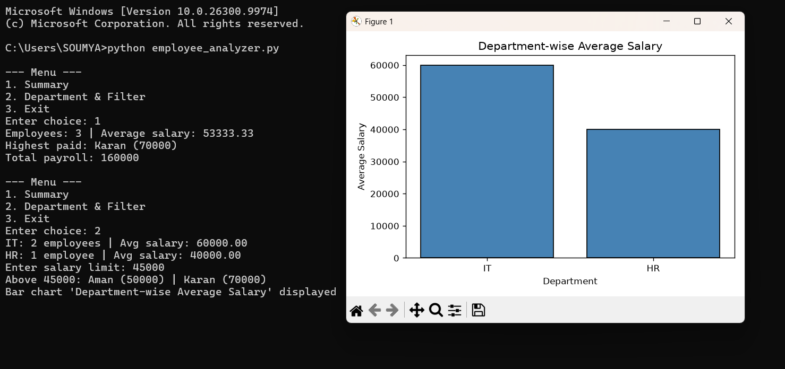
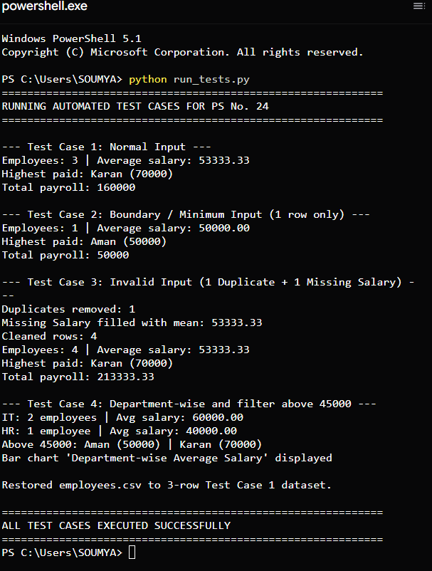

# Project Summary — Employee Data Analyzer (PS No. 24)

**Student Name:** Soumya Kumar Jha  
**Enrollment / ERP No.:** 26-00903  
**Program / Section:** B.Tech CSE (AI & ML) — First Semester / Section – 1J  
**Course:** Programming Fundamentals and Logic Building Using Python (`RU-100-01-0021`)  
**Institution:** Rungta International Skills University, Bhilai, Chhattisgarh  

---

## 1. Overview of the Project

The **Employee Data Analyzer (Problem Statement No. 24)** is a console-based Python 3 data analytics application built using **Pandas** and **Matplotlib**. It reads employee records (`Emp_ID`, `Name`, `Department`, `Salary`, `Experience`) from `employees.csv`, cleans duplicate records and missing salary entries, and provides an interactive menu to compute overall payroll metrics, department-wise statistics, salary-threshold filtering, and visual charts.

### Core Functionalities Implemented

* **Automated Data Cleaning:** Identifies and removes duplicate rows (`drop_duplicates()`) and imputes missing `Salary` values using the arithmetic mean of valid salaries (`fillna()`).
* **Overall Workforce & Payroll Summary (Option 1):** Displays total employee count, mean salary, highest-paid employee (`idxmax()`), and total organization payroll.
* **Department-wise Grouping & Filtering (Option 2):** Uses Pandas `groupby()` to compute employee count and average salary per department, filters employees earning strictly above a user-specified salary limit via boolean indexing, and renders a labeled Matplotlib bar chart (`Department-wise Average Salary`).

---

## 2. Difficulties Faced & How I Overcame Them

1. **Handling Missing and Non-Numeric Salary Values (`NaN` / Blank Cells):**
   * *Difficulty:* In Test Case 3 (`E4, Neha, HR, , 4`), blank or malformed salary entries caused type errors during mathematical aggregations (`mean()` and `sum()`).
   * *Solution:* Used `pd.to_numeric(df['Salary'], errors='coerce')` to safely convert invalid or empty strings into `NaN`, computed the mean of valid numeric entries first, and filled missing cells using `df['Salary'].fillna(mean_val)` while logging the exact cleaning summary (`Duplicates removed`, `Missing Salary filled with mean`, `Cleaned rows`).

2. **Formatting Whole Numbers vs. Decimal Currency Outputs:**
   * *Difficulty:* Pandas converts integer columns containing `NaN` values into floating-point numbers (`50000.0`), which did not match the expected integer formatting in the test cases (e.g., `Highest paid: Karan (70000)` and `Total payroll: 160000`), whereas averages required two decimal places (`53333.33`).
   * *Solution:* Wrote a helper function `fmt_num(val)` that checks `fval.is_integer()` to print clean integers without trailing `.0` when exact, while formatting averages and imputed means to `:.2f`.

3. **Preserving Department Appearance Order in `groupby()`:**
   * *Difficulty:* By default, Pandas `groupby('Department')` sorts department names alphabetically (`HR` before `IT`), whereas Test Case 4 expected departments in their dataset appearance order (`IT` first, then `HR`).
   * *Solution:* Passed `sort=False` inside `df.groupby('Department', sort=False)` so department results display in the exact order required by the specification.

4. **Automating Chart Verification Without Blocking Terminal Execution:**
   * *Difficulty:* Calling `plt.show()` pauses console execution until the user manually closes the pop-up window, blocking automated verification across all four test cases.
   * *Solution:* Modularized `plot_chart(df, block=True, save_path=None)` in `employee_analyzer.py` and used Matplotlib's non-interactive `'Agg'` backend in `run_tests.py` to verify all four test cases in one automated run while keeping interactive pop-up charts for live console usage.

---

## 3. Working Test Cases & Output Screenshots

| Test Case | Scenario | Verified Output |
| :--- | :--- | :--- |
| **Test Case 1** | Normal 3-row dataset (`Option 1`) | `Employees: 3 \| Average salary: 53333.33`, `Highest paid: Karan (70000)`, `Total payroll: 160000` |
| **Test Case 2** | Boundary / Minimum 1-row dataset (`Option 1`) | `Employees: 1 \| Average salary: 50000.00`, `Highest paid: Aman (50000)` |
| **Test Case 3** | Dirty data: 1 duplicate + 1 missing salary (`Option 1`) | `Duplicates removed: 1`, `Missing Salary filled with mean: 53333.33`, `Cleaned rows: 4` |
| **Test Case 4** | Department grouping & filter `> 45000` (`Option 2`) | `IT: 2 employees \| Avg salary: 60000.00`, `HR: 1 employee \| Avg salary: 40000.00`, `Above 45000: Aman (50000) \| Karan (70000)` + Bar Chart |

### Screenshot 1: Interactive Execution & Department-wise Average Salary Bar Chart

### Screenshot 2: Automated Verification of All 4 Test Cases
